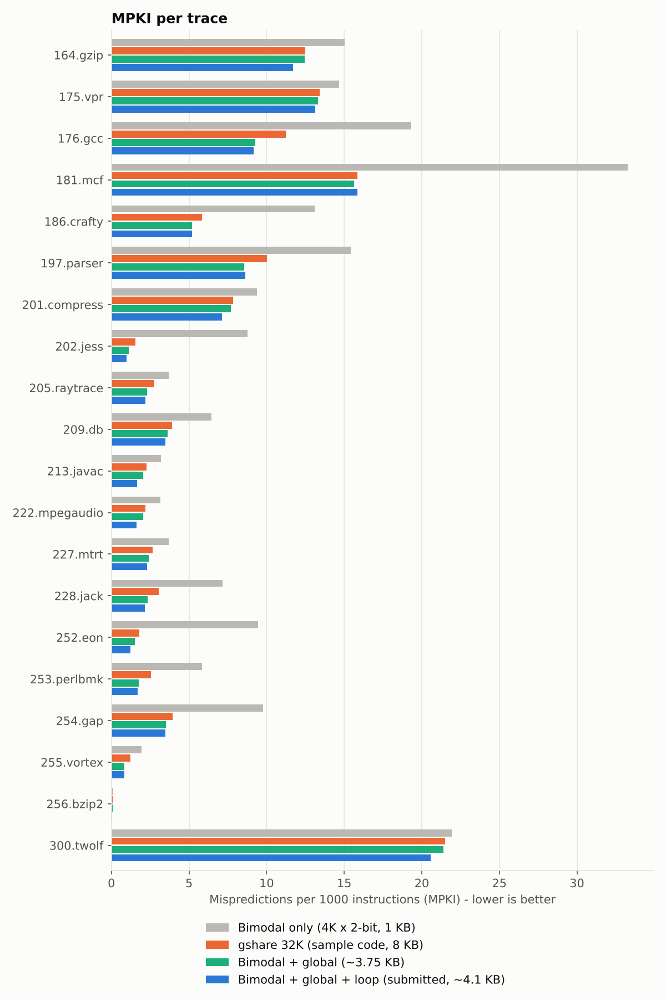
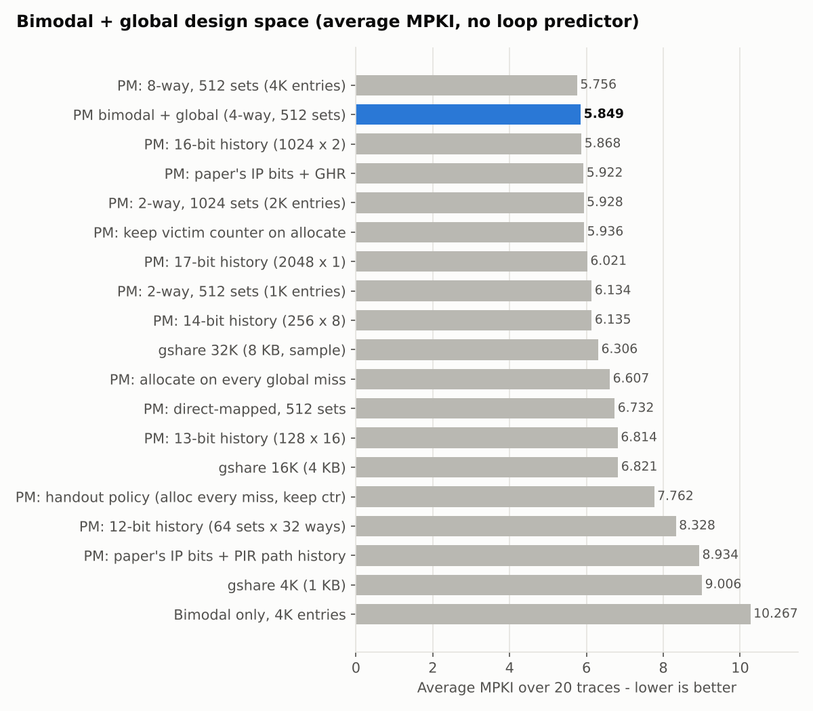
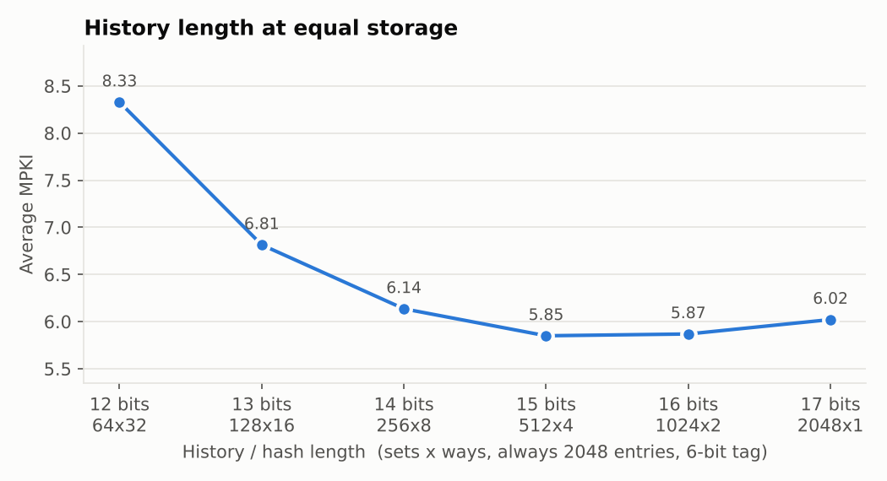
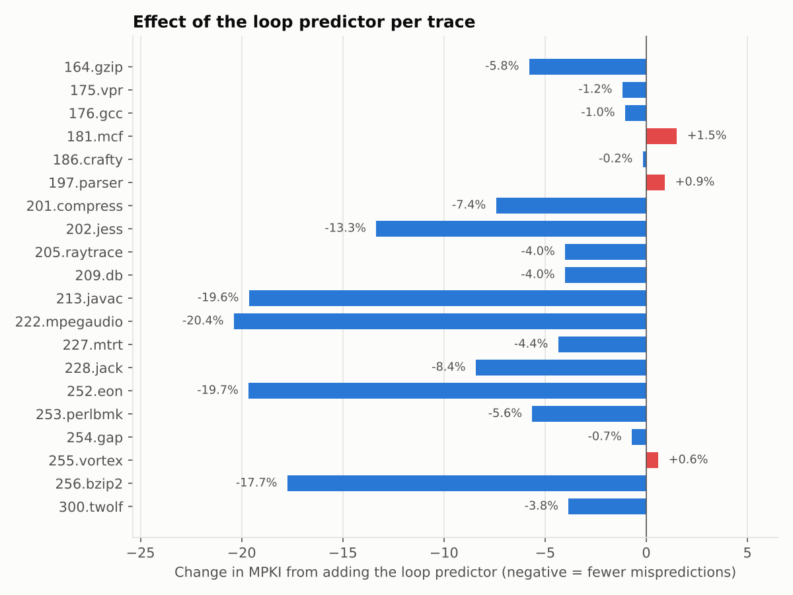
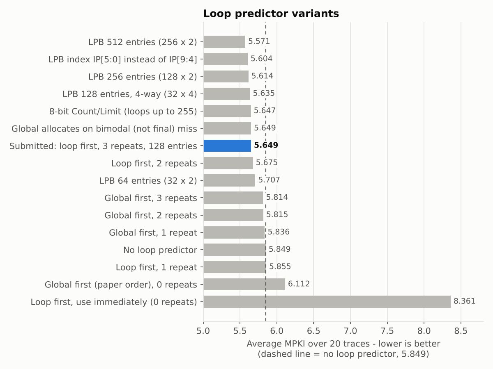

**GitHub repository:** <https://github.com/CoinismRS/LipskyIlan_COSC6385_Programming_Branch_Predictor_HW>

# 1. Summary

I implemented the branch-direction part of the Pentium M predictor in the
`pm_predictor` class in `cbp2-infrastructure-v2/src/my_predictor.h`. It has
three components:

* a **4096-entry bimodal table**;
* a **tagged, 4-way, 512-set global predictor** (required by the
  assignment);
* a **128-entry loop predictor** (optional in the assignment; added as an
  extension).

I evaluated it on all 20 CBP-2 traces.

| Predictor | Storage | Average MPKI (20 traces) |
|---|---:|---:|
| Always taken | 0 | 86.312 |
| Bimodal table alone (4K x 2-bit) | 1 KB | 10.267 |
| gshare, 32K entries (the sample code in the kit) | 8 KB | 6.306 |
| Pentium M bimodal + global (required part) | ~3.75 KB | 5.849 |
| **Pentium M bimodal + global + loop (submitted)** | **~4.1 KB** | **5.649** |

The submitted predictor has **45% fewer mispredictions than the bimodal
table alone**. It is **10% better than the sample 32K-entry gshare while
using about half its storage**. The loop predictor removes another 3.4% of
mispredictions compared with bimodal + global, and improves 17 of the 20
traces.

**Verification:**

* **Worked example.** A unit test replays the 22-branch example in the
  handout (Appendix B). It matches every column of the results table and two
  full snapshots of the global table, LRU bits included.
* **Loop predictor.** A second test checks it learns every trip count from 1
  to 63 exactly and never uses loops too long for its 6-bit counters. It also
  checks re-learning after a trip-count change, the index/tag/LRU fields, and
  that it removes the loop-exit mispredictions end to end.

# 2. What was implemented

## 2.1 Structure

The design follows the Pentium M diagram in the handout. The sizes come from
Uzelac & Milenkovic, *Experiment Flows and Microbenchmarks for Reverse
Engineering of Branch Predictor Structures* (ISPASS 2009).

| Component | Organization | Index / tag |
|---|---|---|
| Bimodal table | 4096 x 2-bit saturating counters | index = IP[11:0] |
| Global history | 15-bit global outcome history register (GHR) | shift in each conditional outcome |
| Global predictor | 512 sets x 4 ways = 2048 entries; entry = {valid, 6-bit tag, 2-bit counter} + LRU | HASH = IP[14:0] XOR GHR; set = HASH[14:6], tag = HASH[5:0] |
| Loop predictor buffer (LPB) | 64 sets x 2 ways = 128 entries; entry = {valid, 6-bit tag, 6-bit Count, 6-bit Limit, 1-bit Prediction, 2-bit confidence} + LRU | set = IP[9:4], tag = IP[15:10] |
| Final prediction | confident LPB hit → loop prediction; else global hit → global counter; else bimodal counter | |

As the handout allows, the path information register (PIR) and its hash are
replaced by a plain global outcome history. This is the same gshare-style
XOR used in the worked example. A PIR variant is also included (section
4.5). Branch target prediction (BTB/iBTB) is not implemented, as the
assignment permits, so `target_prediction` is always 0.

**Storage:**

* Bimodal: 4096 x 2 b = 1 KB.
* Global: 2048 x (1 + 6 + 2 + 2 LRU) b = 2.75 KB.
* LPB: 128 x (1 + 6 + 6 + 6 + 1 + 2 + 1 LRU) b = 368 B.
* Total: about 4.1 KB.

## 2.2 Prediction (`predict`)

For a conditional branch:

1. **Bimodal:** read the counter at `IP[11:0]`. The prediction is its upper
   bit.
2. **Global:** compute `HASH = (IP ^ GHR) & 0x7FFF`, the set `HASH>>6` and
   the tag `HASH & 0x3F`. Compare the tag against all 4 valid ways of that
   set.
3. **Loop:** look up set `IP[9:4]` and tag `IP[15:10]`. On a hit, the loop
   prediction is `Count == Limit ? !Prediction : Prediction`. It is
   *used* only if the entry is confident: its trip count has repeated 3 times
   in a row.
4. **Choose:** use the confident loop prediction if there is one. Otherwise
   use the global prediction on a global hit. Otherwise use the bimodal
   prediction.

Non-conditional branches are predicted taken and do not touch any table. The
simulator only scores conditional branches.

## 2.3 Update (`update`)

* **Bimodal** – the counter is always trained with the outcome.
* **Global, hit** – the hit entry's counter is trained, and the entry
  becomes most-recently-used.
* **Global, miss** – a new entry is allocated if the prediction that was
  available *without* the global table was wrong. That is the loop
  prediction if one was used, otherwise the bimodal prediction. The victim is
  an invalid way if any, otherwise the LRU way. The counter starts weakly
  biased toward the outcome (2 if taken, 1 if not taken).
* **Loop** – see 2.4.
* **GHR** – the outcome is shifted in (15 bits).

LRU is exact in both set-associative tables. Each set keeps a permutation of
ages, and a hit or an allocation makes that way the most recently used. All
sizes and policies are fields of `pm_config`. The default constructor, which
`predict.cc` uses, builds the submitted configuration. Setting
`use_loop = 0` gives the bimodal + global predictor.

## 2.4 Loop predictor

An LPB entry describes a branch that goes in its *Prediction* direction
*Limit* times in a row and then once the other way (the loop exit), over and
over. *Count* is the number of Prediction-direction outcomes since the last
exit.

* **Allocate.** On an LPB miss where the bimodal prediction was wrong, an
  entry is allocated. This is the paper's "first opposite outcome", for
  example the first exit of a loop whose body the bimodal table predicts as
  taken. *Prediction* is set to the direction that was just broken,
  *Count* = 0, *Limit* is unknown, and the victim is the LRU way.
* **Inside the loop** (outcome = Prediction): `Count++`.
    * If Count goes past Limit, the loop ran longer than learned, so
      confidence is reset.
    * If Count overflows its 6 bits, the loop is too long to track. Limit
      becomes unknown and the entry is never used.
* **Exit** (outcome ≠ Prediction):
    * If Count = Limit, the trip count repeated, so confidence is
      incremented (saturating at 3).
    * Otherwise Limit = Count and confidence is reset.
    * Count returns to 0.
* **Re-orientation.** Two exits in a row (Count = 0) mean the entry is
  pointing the wrong way, for example because it was allocated while the
  bimodal counter was still cold. Prediction is flipped and the entry
  retrains.

## 2.5 Deliberate differences from the handout and the paper

1. **Global allocation (vs. the handout example).** The handout allocates a
   global entry on *every* global miss and keeps the victim's old counter.
   My code supports exactly that (`PM_ALLOC_ALWAYS` + `PM_CTR_KEEP`), and
   the worked-example test runs in that mode. For the submitted predictor I
   allocate only when the non-global prediction was wrong. This reserves the
   global table for branches the cheaper components cannot handle, and cuts
   MPKI by 25% (section 4.2).
2. **Loop vs. global priority (vs. the paper).** The paper reports that a
   global hit overrides a loop hit. In this model that makes the loop
   predictor nearly useless. In a loop longer than the 15-bit history, the
   history before the exit is all "taken", the same as before every other
   iteration. The global entry for that history therefore hits at the exit
   and predicts "taken" again. With global first, the LPB lowers MPKI only
   from 5.849 to 5.814. With loop first, it reaches 5.649. Both orders are
   selectable (`loop_over_global`).
3. **Confidence counter (addition to the paper).** The paper lists only
   Tag, Count, Limit and Prediction. Without a confidence check, the LPB
   overrides the bimodal and global predictions for every non-loop branch it
   captures, giving 8.361 MPKI. I added a 2-bit counter and use the LPB only
   after the trip count repeats 3 times.
4. **No BTB.** In the real chip an LPB hit also requires a BTB hit. The BTB
   is not modeled, so this check is treated as always true.

# 3. Verification

`make test` in `src/` runs two programs (output in
`results/test_output.txt`).

**`test/test_example.cc` – the handout's worked example.** It builds
`pm_predictor` at the handout's scale, with the loop predictor off:

* 8-bit addresses and a 16-entry local table indexed by IP[5:2]
* a 4-bit GHR
* 4 rows x 2 ways with 2-bit tags

It uses the handout's initial counter values and its allocation policy. It
replays the 22 branch outcomes and checks the GHR, hash, row, tag, local
counter, and the local, global and final predictions at every step. It also
compares every field of the global table (valid, tag, counter, LRU) with the
handout before steps 12 and 22.

```
step br  addr  out  GHR  hash row tag  lctr local global final
   1 b1  0x44  T    0000 0001   0  01     1     N      -     N
   ...
  14 b2  0x6C  NT   1010 0001   0  01     2     T      N     N
   ...
  22 b3  0x90  T    0011 0111   1  11     3     T      -     T
PASS: all 22 steps and both global-table snapshots match the handout.
```

**`test/test_loop.cc` – the loop predictor** (27 checks):

```
taken loop    body= 1 : LPB used   40/  40, LPB misses 0, total misses 0
taken loop    body=10 : LPB used  220/ 220, LPB misses 0, total misses 0
taken loop    body=40 : LPB used  820/ 820, LPB misses 0, total misses 0
taken loop    body=63 : LPB used 1280/1280, LPB misses 0, total misses 0
not-taken loop body=12 : LPB used  260/ 260, LPB misses 0
too-long loops (64, 100): LPB never used
trip count 8 -> 11       : 1 miss, re-learned after 3 confirming runs
LPB index/tag fields, aliasing and LRU replacement OK
end-to-end, 1000 runs of a 30-iteration loop: loop-branch misses 1607 without LPB, 0 with LPB
PASS: all 27 loop predictor checks.
```

I also ran the full predictor through both the kit's `predict` binary (via
`run.sh`) and the experiment driver. Both give the same MPKI on every trace.

# 4. Results: bimodal + global predictor

MPKI is direction mispredictions per 1000 instructions, as reported by
`predict` (each trace is 100M instructions). Lower is better.

## 4.1 Per-trace results



| Trace | Bimodal only | gshare 32K | Bimodal + global | **+ loop (submitted)** | Change from loop |
|---|---:|---:|---:|---:|---:|
| 164.gzip | 15.031 | 12.473 | 12.439 | **11.719** | -5.8% |
| 175.vpr | 14.673 | 13.415 | 13.298 | **13.141** | -1.2% |
| 176.gcc | 19.313 | 11.254 | 9.266 | **9.169** | -1.0% |
| 181.mcf | 33.271 | 15.837 | 15.624 | **15.861** | +1.5% |
| 186.crafty | 13.097 | 5.837 | 5.208 | **5.199** | -0.2% |
| 197.parser | 15.420 | 10.008 | 8.542 | **8.621** | +0.9% |
| 201.compress | 9.368 | 7.831 | 7.688 | **7.117** | -7.4% |
| 202.jess | 8.773 | 1.562 | 1.124 | **0.974** | -13.3% |
| 205.raytrace | 3.704 | 2.756 | 2.293 | **2.201** | -4.0% |
| 209.db | 6.437 | 3.909 | 3.608 | **3.463** | -4.0% |
| 213.javac | 3.198 | 2.267 | 2.052 | **1.649** | -19.6% |
| 222.mpegaudio | 3.166 | 2.188 | 2.031 | **1.617** | -20.4% |
| 227.mtrt | 3.682 | 2.657 | 2.389 | **2.285** | -4.4% |
| 228.jack | 7.175 | 3.033 | 2.349 | **2.151** | -8.4% |
| 252.eon | 9.443 | 1.807 | 1.506 | **1.210** | -19.7% |
| 253.perlbmk | 5.848 | 2.554 | 1.774 | **1.674** | -5.6% |
| 254.gap | 9.760 | 3.926 | 3.509 | **3.484** | -0.7% |
| 255.vortex | 1.930 | 1.222 | 0.830 | **0.835** | +0.6% |
| 256.bzip2 | 0.113 | 0.094 | 0.062 | **0.051** | -17.7% |
| 300.twolf | 21.943 | 21.489 | 21.390 | **20.568** | -3.8% |
| **Average** | 10.267 | 6.306 | 5.849 | **5.649** | -3.4% |

Bimodal + global alone beats the sample gshare on all 20 traces. With the
loop predictor added, it does so on 19; mcf is 0.2% behind (15.861
vs. 15.837).

**How the two components split the work** (bimodal + global, no loop
predictor):

* On average the global table supplies 41% of predictions and is right on
  92.5% of its hits. Those are mostly the hard, correlated branches.
* The bimodal table supplies the rest and is right 98.1% of the time when
  used, because the branches it could not handle have been moved to the
  global table.

**Where it helps and where it doesn't:**

* The largest gains over the bimodal table alone are on programs with many
  correlated branches: gcc (−52%), crafty (−60%), jess (−87%), eon (−84%),
  perlbmk (−70%) and mcf (−53%).
* twolf, mcf, vpr and gzip stay above 11 MPKI for every configuration
  tested, with or without the loop predictor. Their branches depend on data and do not correlate well with 15
  bits of history.

## 4.2 Allocation policy for the global table

| Variant (no loop predictor) | Avg MPKI | Global hit rate | Allocations per trace |
|---|---:|---:|---:|
| **Allocate only on bimodal mispredict, weak-init counter** | **5.849** | 41% | 0.15 M |
| Allocate only on bimodal mispredict, keep victim counter | 5.936 | 41% | 0.15 M |
| Allocate on every global miss, weak-init counter | 6.607 | 87% | 1.73 M |
| Allocate on every global miss, keep victim counter (handout example) | 7.762 | 87% | 1.73 M |

Allocating on every miss produces almost 12x more allocations. They evict
useful entries, and most of the new ones are for easy branches that the
bimodal table was already predicting correctly. Filtered allocation spends
global capacity only where the bimodal table fails.

## 4.3 Associativity, size and hash



* **Associativity.** At 512 sets: direct-mapped 6.732, 2-way 6.134, 4-way
  5.849, 8-way 5.756 average MPKI. The 2-way option the assignment allows
  costs about 5% more mispredictions than 4-way at half the storage. A 2-way
  table with 1024 sets has the same capacity as 4-way and comes within 1.4%
  of it (5.928).
* **Hash bits.** I also tried the Pentium M's own IP bit selection: index =
  IP[12:4]^H[14:6], tag = IP[18:13]^H[5:0]. It scored 5.922, about the same
  as the plain XOR (5.849).

## 4.4 History length at equal storage



All points have 2048 entries and a 6-bit tag; only sets x ways changes.
Short histories (12–13 bits) do poorly: the hash is only that wide, so few
address bits survive and unrelated branches alias. Performance flattens at
15–16 bits. The Pentium M's 15-bit hash with 512 x 4 sits at the minimum.

## 4.5 Real Pentium M path history (PIR)

I implemented the ISPASS 2009 PIR update rule and used it in place of the
GHR. On a taken conditional branch, `PIR = (PIR << 2) ^ IP[18:4]`. On an
indirect branch, `PIR = (PIR << 2) ^ {IP[18:10], target[5:0]}`.

In isolation it does clearly worse: 8.934 MPKI. It records only about 8
taken branches and no not-taken outcomes. In the real chip it works together
with the BTB, which is not modeled. The paper's description of how the hash
halves are concatenated is also ambiguous. So I kept the outcome-history
GHR, which is what the assignment asks for.

# 5. Results: loop predictor

## 5.1 Effect per trace



The loop predictor supplies 9.9% of all conditional predictions on average,
at 98.0% accuracy. It ranges from 0.2% on bzip2 to 58.8% on eon, a C++ ray
tracer full of short fixed-count loops.

**Where it helps.** It removes 13–20% of the remaining mispredictions on
jess, javac, mpegaudio, eon and bzip2, and roughly 4–8% on gzip, compress,
raytrace, db, mtrt, jack, perlbmk and twolf.

**Where it hurts.** It makes three traces slightly worse: mcf (+1.5%),
parser (+0.9%) and vortex (+0.6%). mcf and parser have the lowest LPB
accuracy of all traces (about 95%). Their loops have data-dependent trip
counts that repeat a few times, which makes the entry confident, and then
change, which costs one miss per change. On vortex the change is very small
(+0.005 MPKI).

## 5.2 Design choices



* **Priority is what matters most.** With the paper's order (global hit
  wins), the best result is 5.814 (−0.6%), and the unit test shows why: a
  loop of 20 or more iterations still costs one miss per run, because the
  all-taken global entry predicts the exit wrong. Letting a confident LPB
  entry win gives 5.649 (−3.4%) and zero misses on those loops.
* **Confidence is required.** Using the LPB as soon as a Limit is learned
  is disastrous with loop-first priority: 8.361, worse than no loop
  predictor. Every non-loop branch that once mispredicted then gets
  "predicted" by a meaningless trip count. With global-first priority it
  still hurts (6.112). Requiring 2–3 repeats gives the best results; 3 is
  the submitted value.
* **Size.** 64 entries gives 5.707, 128 (Pentium M) 5.649, 256 5.614 and 512
  5.571. Gains are modest beyond the Pentium M size.
* **Indexing.** Using IP[5:0] instead of IP[9:4] for the set index gives
  5.604. The paper's index drops IP[3:0], so branches in the same 16-byte
  fetch block share an entry. That suits the real fetch-block-based front
  end, but in this per-branch simulator it causes some aliasing.
* **Little effect:** 8-bit Count/Limit, tracking loops up to 255 iterations
  (5.647 vs. 5.649); 4-way instead of 2-way at 128 entries (5.635); and
  allocating global entries on bimodal rather than final mispredictions
  (no measurable difference).

# 6. Conclusions

* A small hybrid in the style of the Pentium M (about 4 KB) beats a 32K-entry
  gshare (8 KB) by 10%. Tags and set-associativity remove most destructive
  aliasing in the global table, and the bimodal table cheaply handles the
  majority of branches that are simply biased.
* **Which branches the global table admits matters more than its size.**
  Allocating only on mispredictions is worth 25% fewer mispredictions
  compared with allocating on every miss.
* The **loop predictor** is a small structure (368 B) that removes 3.4% of
  the remaining mispredictions, and up to 20% on loop-heavy traces. It only
  pays off if a confident loop entry can override the global table and is
  used only after its trip count has repeated.

**Possible next step:** the BTB/iBTB target predictors (the
`cpm_predictor` extra credit).

# 7. Code used / references

* All predictor code, both set-associative LRU tables and the tests were
  written from scratch for this assignment. No external cache code was used;
  the suggested L1-Cache-Simulator repository was not needed.
* The simulation infrastructure, traces and sample `gshare_predictor` are
  from the CBP-2 kit (`cbp2-infrastructure-v2`) provided with the
  assignment.
* V. Uzelac and A. Milenkovic, "Experiment Flows and Microbenchmarks for
  Reverse Engineering of Branch Predictor Structures," ISPASS 2009 – sizes,
  index/tag fields, LPB organization and the PIR update rule.
* M. Milenkovic, A. Milenkovic and J. Kulick, "Demystifying Intel Branch
  Predictors," WDDD 2002 – background.
* Assignment handout, Appendix B – the hybrid predictor worked example used
  for verification.
